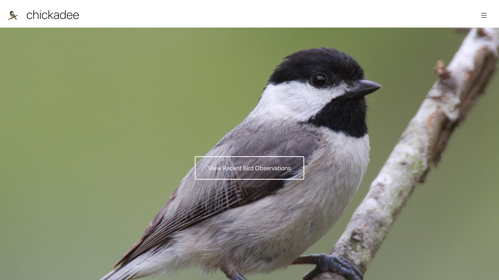
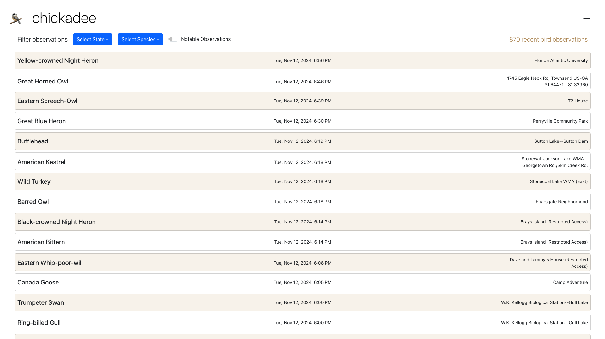
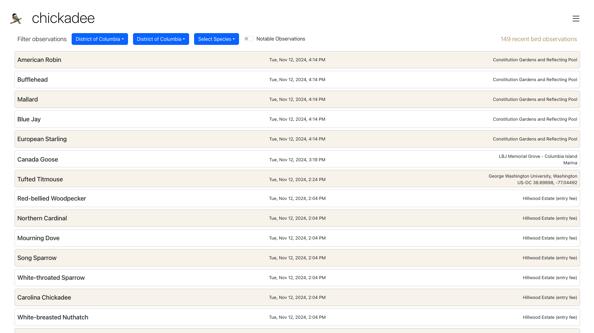
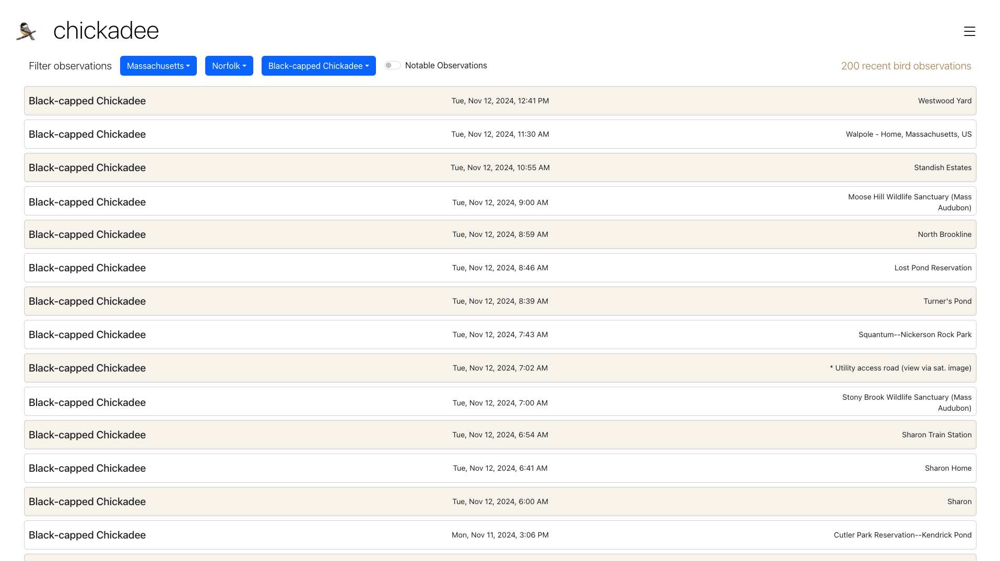
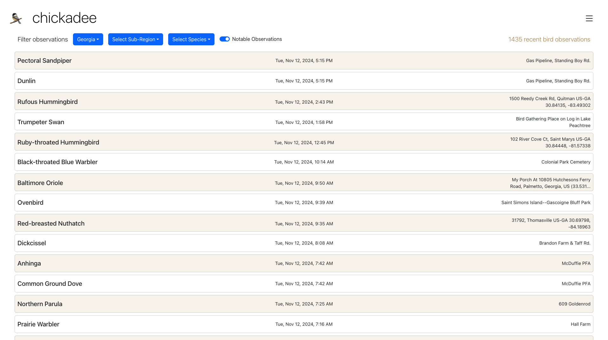
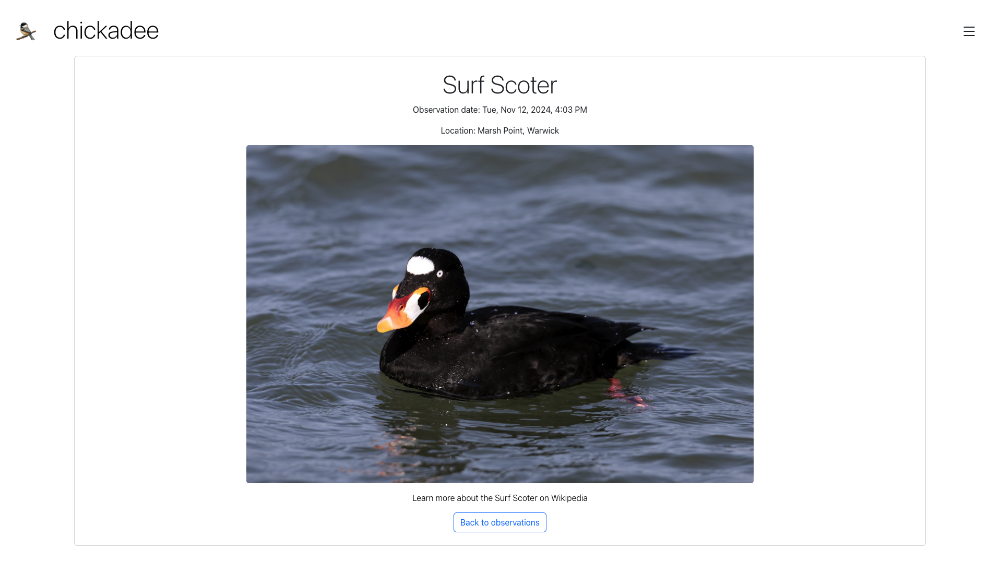

# chickadee 

A web app to view recent bird observations using [eBird](https://ebird.org/home) API data.

*chickadees are known for having exceptional memories. they have an incredible ability to remember where they've cached food in their environment. studies have shown that they can remember the locations of thousands of caches for months.*

## ⚙️ setup instructions

- download [node.js](https://nodejs.org/)
- download [neltify-cli](https://docs.netlify.com/cli/get-started/)
- create an [eBird account](https://ebird.org/home) and access your eBird API Key, create a `.env` file and assign your key to `EBIRD_API_KEY`
  - when deploying, add `EBIRD_API_KEY` to your Netlify site's environment variables (scope: Functions).
- `npm i`
- `netlify dev` to run app using netlify functions

## 🧑‍💻 functionality
- browse bird observations worldwide: filter by country, then region (e.g. state) and sub-region (e.g. county)
- filter by specific species within any selected area
- search 'notable' observations (which eBird defines as birds rarely spotted or birds in unusual locations)
- switch between a list view and a map view of observations
- click on a bird to view its picture (sourced from Wikipedia, with photographer and license credit) and a link to its Wikipedia page
- more features coming soon!

## ⚡️ caching
like its namesake, chickadee caches things so it doesn't have to go looking for them again. responses from the Netlify functions are cached on Netlify's CDN and shared by every visitor, so repeat requests never reach the eBird or Wikipedia APIs:

| data | shared CDN cache | browser cache |
|---|---|---|
| recent observations | 30 min (+1 h stale-while-revalidate) | 5 min |
| region lists | 7 days | 1 day |
| eBird taxonomy | 7 days | 1 day |
| Wikipedia images | 30 days (1 day if no image) | 1 day |

error responses are never cached, and `Netlify-Vary` keeps unrelated query parameters from bypassing the cache.

## 🙏 data & attribution
- bird observation data from [eBird.org](https://ebird.org), Cornell Lab of Ornithology, used under the [eBird API Terms of Use](https://www.birds.cornell.edu/home/ebird-api-terms-of-use/) and [eBird Data Access Terms of Use](https://www.birds.cornell.edu/home/ebird-data-access-terms-of-use/). chickadee is a non-commercial hobby project and is not affiliated with or endorsed by the Cornell Lab of Ornithology
- bird photos from Wikipedia / Wikimedia Commons, credited in the app with each photographer and license
- landing page photo: Carolina Chickadee by Dan Pancamo, [CC BY-SA 2.0](https://creativecommons.org/licenses/by-sa/2.0)
- maps &copy; [OpenStreetMap](https://www.openstreetmap.org/copyright) contributors

## 💻 tech stack
- Node.js
- JavaScript
- React
- Netlify/Netlify Functions (with CDN caching)
- Leaflet / React Leaflet
- [eBird API](https://documenter.getpostman.com/view/664302/S1ENwy59)
- [MediaWiki API](https://www.mediawiki.org/wiki/API:Main_page)

## 🚀 deployed app

View chickadee on [Netlify](https://chickadeeapp.netlify.app/)!

### 📸 app screenshots

#### landing page

#### view recent bird observations

#### filter observations by region

#### filter observations by species

#### view "notable" observations

#### view observation with image

