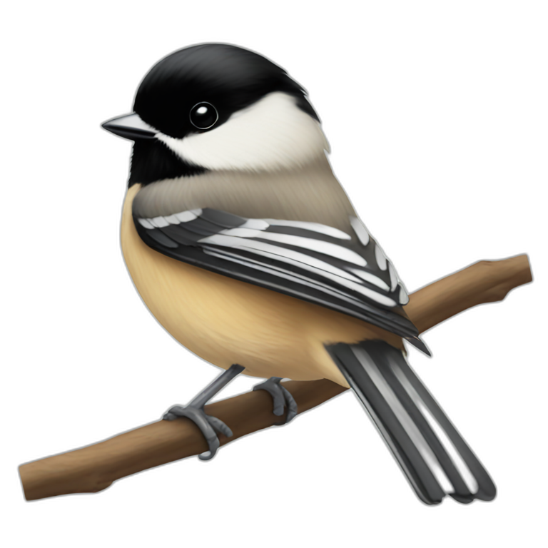
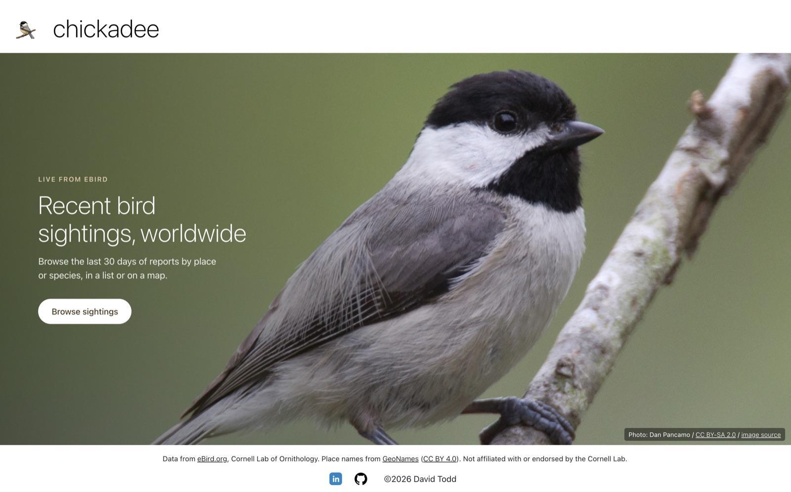
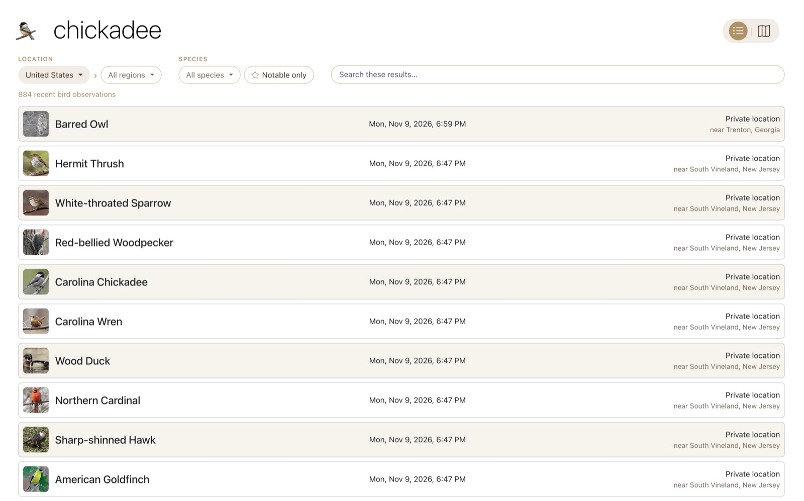
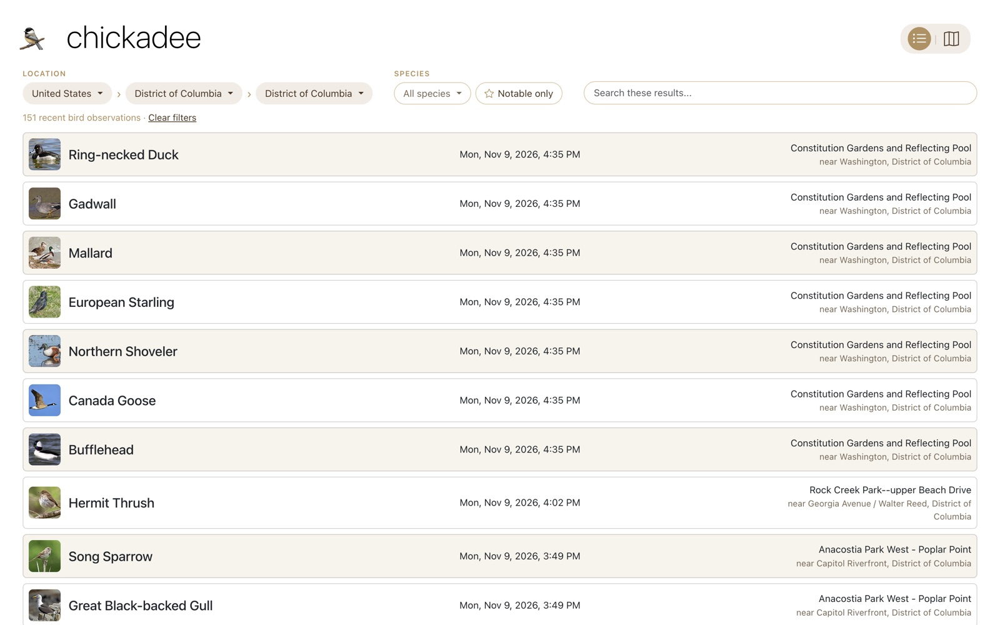
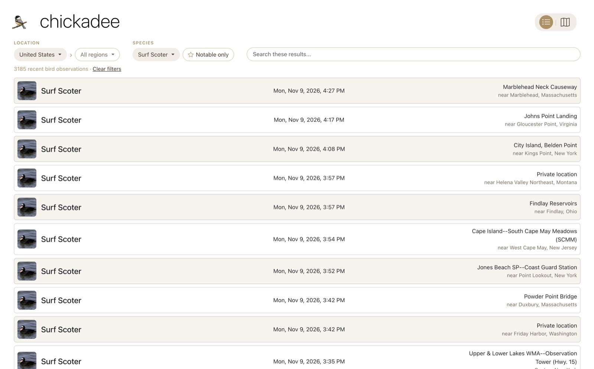
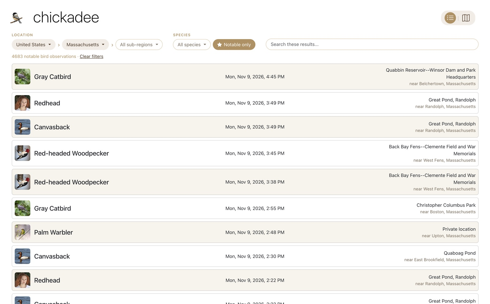
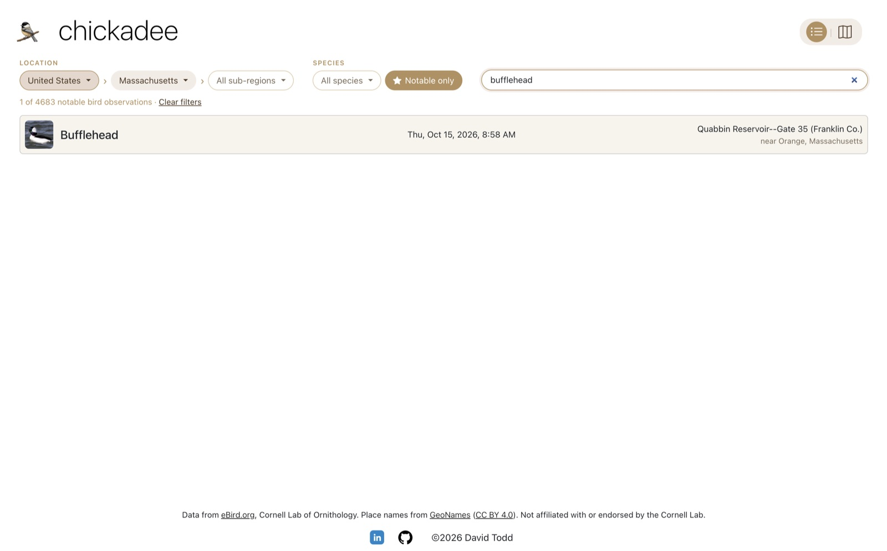
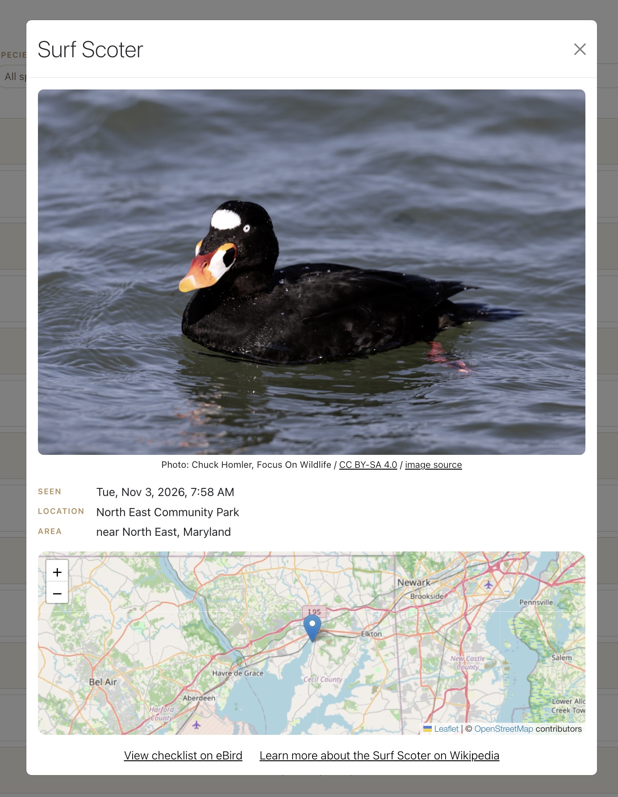
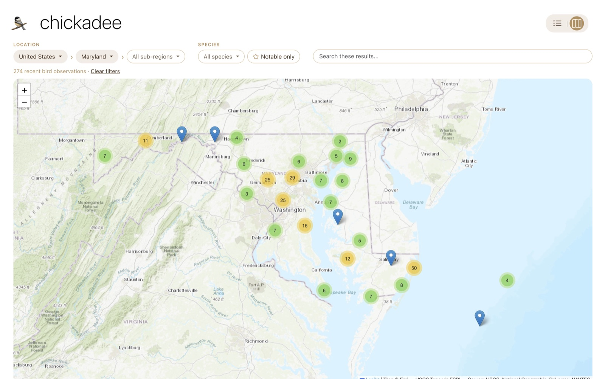
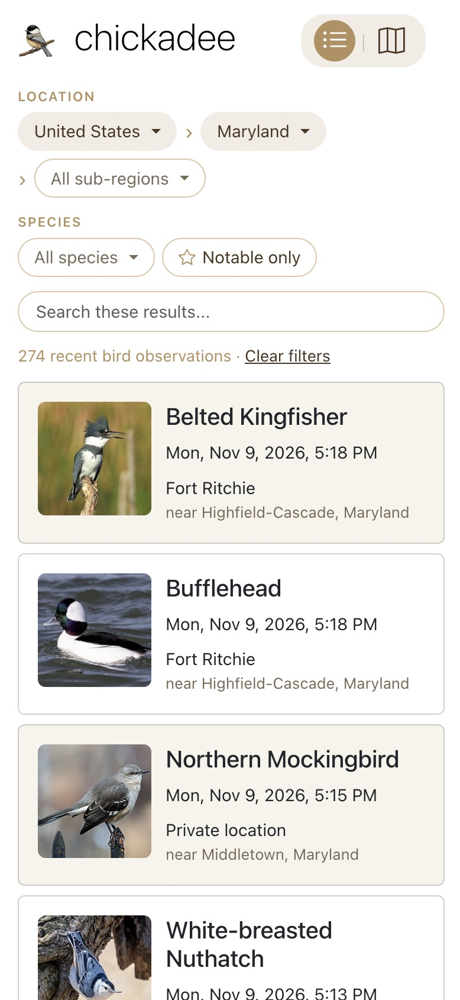

# chickadee 

A web app to browse recent bird sightings from around the world, using [eBird](https://ebird.org/home) API data.

*chickadees are known for having exceptional memories. they have an incredible ability to remember where they've cached food in their environment. studies have shown that they can remember the locations of thousands of caches for months.*

## 🚀 deployed app

View chickadee on [Netlify](https://chickadeeapp.netlify.app/)!

## 🧑‍💻 features

### browse and filter
- browse the last 30 days of bird observations worldwide, as a list or on a map
- narrow by place: country, then region (e.g. state) and sub-region (e.g. county)
- filter by species, limited to species seen in the selected area (with a switch to include every species ever recorded there)
- show only 'notable' observations (which eBird defines as birds rarely spotted or birds in unusual locations)
- search the loaded results by bird name, and clear every filter in one click

### observation details
- click any observation in the list or on the map to open its details in a popup, without leaving the page
- each observation shows a photo of the species (from Wikipedia, with photographer and license credit), when and where it was seen, a small map, and links to its eBird checklist and Wikipedia page
- every observation is labelled with its nearest town and state (e.g. "near Blacksburg, Virginia"), worldwide

### shareable links
- the current filters, search and list/map view are kept in the URL, so any view can be bookmarked or shared
- an open observation has its own URL too, so a pasted link opens straight into its details

### privacy
- eBird includes exact coordinates and street addresses for personal locations like yards and homes. chickadee hides these before they reach the browser: coordinates are rounded to about 1 km, the name is shown as "Private location", and the link to the eBird checklist (which shows the exact spot) is left out

## ⚙️ setup instructions

- download [node.js](https://nodejs.org/)
- download [netlify-cli](https://docs.netlify.com/cli/get-started/)
- create an [eBird account](https://ebird.org/home) and access your eBird API Key, create a `.env` file and assign your key to `EBIRD_API_KEY`
  - when deploying, add `EBIRD_API_KEY` to your Netlify site's environment variables (scope: Functions).
- `npm i`
- `netlify dev` to run app using netlify functions

### refreshing the bundled data

town names and species photos are looked up from data files committed to the repo, so the app never calls a geocoding or Wikipedia API while people browse. rebuild them occasionally:

| data | file | rebuild with | when |
|---|---|---|---|
| towns of 1,000+ people, worldwide ([GeoNames](https://www.geonames.org)) | `netlify/lib/places-data.js` | `node scripts/build-places.mjs` | rarely |
| each species' Wikipedia lead photo and credit | `netlify/lib/species-images-data.js` | `node scripts/build-species-images.mjs` | after eBird's yearly taxonomy update, or if photos stop loading |

the photo script follows the [Wikimedia Robot policy](https://wikitech.wikimedia.org/wiki/Robot_policy): one request at a time, about one per second, 50 species per request. a full run makes about 460 requests and takes around 15 minutes.

## ⚡️ caching
like its namesake, chickadee caches things so it doesn't have to go looking for them again. responses from the Netlify functions are cached on Netlify's CDN and shared by every visitor, so repeat requests never reach the eBird API:

| data | shared CDN cache | browser cache |
|---|---|---|
| recent observations | 30 min (+1 h stale-while-revalidate) | 5 min |
| region lists | 7 days | 1 day |
| eBird taxonomy | 7 days | 1 day |
| species photos and credits | 30 days | 1 day |

error responses are never cached, and `Netlify-Vary` keeps unrelated query parameters from bypassing the cache.

photos themselves load straight from Wikimedia's image servers at [standard thumbnail sizes](https://www.mediawiki.org/wiki/Common_thumbnail_sizes) (120px in the list, 250px on the map, 500/960px in the details popup), and list thumbnails only load once they scroll into view.

## 🙏 data & attribution
- bird observation data from [eBird.org](https://ebird.org), Cornell Lab of Ornithology, used under the [eBird API Terms of Use](https://www.birds.cornell.edu/home/ebird-api-terms-of-use/) and [eBird Data Access Terms of Use](https://www.birds.cornell.edu/home/ebird-data-access-terms-of-use/). chickadee is a non-commercial hobby project and is not affiliated with or endorsed by the Cornell Lab of Ornithology
- bird photos from Wikipedia / Wikimedia Commons (free licenses only), credited in the app with each photographer and license
- place names from [GeoNames](https://www.geonames.org), [CC BY 4.0](https://creativecommons.org/licenses/by/4.0/)
- landing page photo: Carolina Chickadee by Dan Pancamo, [CC BY-SA 2.0](https://creativecommons.org/licenses/by-sa/2.0)
- maps &copy; [OpenStreetMap](https://www.openstreetmap.org/copyright) contributors and Esri

## 💻 tech stack
- Node.js
- JavaScript
- React / React Router
- Netlify/Netlify Functions (with CDN caching)
- Leaflet / React Leaflet
- [eBird API](https://documenter.getpostman.com/view/664302/S1ENwy59)
- [MediaWiki API](https://www.mediawiki.org/wiki/API:Main_page) (build script only)
- [GeoNames](https://www.geonames.org) data (bundled)

## 📸 screenshots

### landing page

### recent observations, with photos and nearest towns

### filter by place

### filter by species

### notable observations only

### search the results

### observation details

### map view

### on mobile

